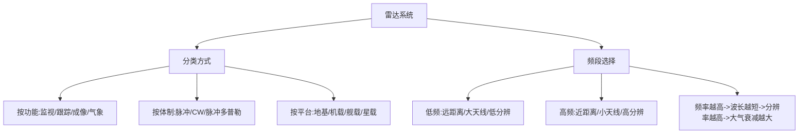

## 小节概述

雷达(Radio Detection and Ranging)通过发射电磁波并接收目标回波来探测目标的存在、位置和运动状态。根据功能、工作体制和平台的不同，雷达系统有多种分类方式。

不同频段的电磁波在传播特性、天线尺寸和大氣衰减等方面有显著差异，因此雷达的工作频段选择直接决定了系统的性能和用途。IEEE制定了标准的雷达频段命名规则，从低频的HF频段到毫米波的W频段，覆盖了从超视距雷达到高分辨率成像雷达的各种应用。

## 关键知识点

### 一、雷达分类体系

雷达按照功能可分为以下几大类：

1. **监视雷达(Surveillance Radar)**：用于大范围搜索和检测目标，重点关注探测距离和覆盖空域。典型应用包括空中交通管制(ATC)雷达和防空预警雷达。

2. **跟踪雷达(Tracking Radar)**：持续测量单个或多个目标的精确轨迹参数（距离、角度、速度）。需要高精度角度测量，常采用单脉冲(Monopulse)技术。

3. **成像雷达(Imaging Radar)**：获取目标的高分辨率图像，如合成孔径雷达(SAR)和逆合成孔径雷达(ISAR)。

4. **气象雷达(Weather Radar)**：探测降水粒子的分布和运动。

按照工作体制分类：

- **脉冲雷达(Pulsed Radar)**：发射高功率短脉冲，收发分时。这是最常见的雷达体制。
- **连续波雷达(CW Radar)**：连续发射，收发同时。测距需要频率调制。
- **脉冲多普勒雷达(Pulsed Doppler Radar)**：结合脉冲测距和多普勒测速能力。

### 二、雷达频段划分

电磁波频率 $f$ 与波长 $\lambda$ 的关系由光速 $c$ 联系：

$$
\lambda = \frac{c}{f}
$$

其中光速 $c = 3 \times 10^8$ m/s。频率的单位是赫兹(Hz)，波长的单位是米(m)。

IEEE标准雷达频段划分：

| 频段 | 频率范围 | 典型波长 | 主要应用 | 传播特性 |
|------|---------|---------|---------|---------|
| HF | 3-30 MHz | 100-10 m | 超视距雷达(OTH) | 电离层反射，可超视距 |
| VHF | 30-300 MHz | 10-1 m | 远程监视 | 绕射能力强 |
| UHF | 300-1000 MHz | 1-0.3 m | 弹道导弹预警 | 穿透植被能力强 |
| L | 1-2 GHz | 30-15 cm | 远程监视、ATC | 大气衰减小 |
| S | 2-4 GHz | 15-7.5 cm | 中程监视、天气 | 适中衰减 |
| C | 4-8 GHz | 7.5-3.75 cm | 火控雷达、跟踪 | 分辨率适中 |
| X | 8-12 GHz | 3.75-2.5 cm | 机载雷达、SAR | 分辨率高 |
| Ku | 12-18 GHz | 2.5-1.67 cm | 高精度跟踪 | 雨衰减增大 |
| K | 18-27 GHz | 1.67-1.11 cm | 汽车雷达 | 衰减大 |
| Ka | 27-40 GHz | 1.11-0.75 cm | 高分辨率SAR | 衰减很大 |
| W | 75-110 GHz | 4-2.7 mm | 毫米波雷达 | 衰减极大，分辨极高 |

频段选择的主要权衡：
- **低频**（HF-UHF）：传播损耗小、绕射能力强、天线尺寸大、分辨率低
- **高频**（X-W）：分辨率高、天线尺寸小、传播损耗大、受天气影响大

### 三、频率与波长的物理意义

频率 $f$ 表示电磁波每秒振荡的次数，波长 $\lambda$ 表示一个完整振荡周期内电磁波传播的空间距离。

$$
\lambda = \frac{c}{f} \quad \Rightarrow \quad \lambda \propto \frac{1}{f}
$$

**工程含义**：天线尺寸通常与波长成正比（典型为 $\lambda/2$ 或 $\lambda$），因此频率越高，天线越小，但加工精度要求也越高。

## 知识结构

## 关键术语

| 英文 | 中文 | 解释 |
|------|------|------|
| Radar Band | 雷达频段 | IEEE标准化的工作频率范围 |
| Wavelength | 波长 | 电磁波一个完整周期的空间传播距离 |
| Surveillance Radar | 监视雷达 | 大范围搜索和检测目标的雷达 |
| Tracking Radar | 跟踪雷达 | 持续测量目标轨迹的雷达 |
| Frequency | 频率 | 电磁波每秒的振荡次数(Hz) |
