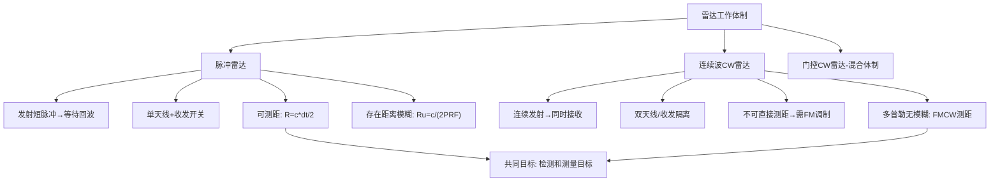

## 小节概述

雷达的两种基本工作体制是脉冲雷达(Pulsed Radar)和连续波雷达(CW Radar)。脉冲雷达通过发射短促的高功率脉冲并随后等待回波来实现距离测量，而连续波雷达则持续发射电磁波，收发同时工作。这两种体制各有优缺点，适用于不同的应用场景。还有一种混合体制——门控连续波雷达(Gated CW Radar)，结合了两者的优势。

理解这两种体制的本质差异——特别是它们如何解决[发射和接收同时进行"这一根本矛盾——是掌握雷达系统设计的基础。

## 关键知识点

### 一、脉冲雷达(Pulsed Radar)

**工作原理**：脉冲雷达发射一个持续时间很短的强功率脉冲，然后关闭发射机，打开接收机等待回波。目标距离通过测量脉冲从发射到接收的时间差 $\Delta t$ 来获得：

$$
R = \frac{c \cdot \Delta t}{2}
$$

其中因子2是因为电磁波走了往返路径（雷达到目标再到雷达）。

**收发隔离机制**：脉冲雷达使用**收发开关(T/R Switch)**在发射和接收模式之间切换。发射时，开关将发射机连接到天线，同时保护接收机免遭高功率损坏；接收时，开关将天线连接到接收机。这种分时工作机制允许脉冲雷达使用**单个天线**完成收发。

**关键参数**：
- 峰值功率(Peak Power) $P_t$：发射脉冲期间的瞬时功率，可以非常高
- 平均功率(Average Power) $P_{av} = P_t \cdot \tau \cdot PRF$：脉冲功率的时间平均，与占空比成正比
- 占空比(Duty Cycle) $d = \tau \cdot PRF$：发射时间占总时间的比例
- 脉冲重复频率(Pulse Repetition Frequency) $PRF$：每秒发射的脉冲数

**优点**：可使用单天线、可测量距离、峰值功率高
**缺点**：存在距离模糊、多普勒测量能力受PRF限制

### 二、连续波雷达(CW Radar)

**工作原理**：CW雷达持续发射电磁波，同时持续接收回波。由于发射和接收同时进行，无法直接通过时间延迟测量距离（因为没有时间标记）。

**收发隔离机制**：CW雷达必须使用**两个独立的天线**——一个专用于发射，另一个专用于接收——或者使用某种双工技术（如极化隔离、环形器等）实现收发同时工作。收发隔离问题是CW雷达设计的主要挑战之一。

**测速能力**：CW雷达的多普勒测量性能优异。由于没有脉冲间隔的限制，可以测量任意大小的多普勒频移。当目标运动时，回波频率与发射频率之间存在多普勒偏移 $f_d$，因此：

$$
f_d = \frac{2v_r}{\lambda} \quad \Rightarrow \quad v_r = \frac{\lambda f_d}{2}
$$

**调频测距**：纯粹的CW雷达无法测距，但通过对发射频率进行调制（如线性调频FMCW），可以间接测量距离。调频测距的基本思想是：发射频率随时间变化，回波频率与当前发射频率的差频与距离成正比。

### 三、门控CW雷达(Gated CW Radar)

门控CW雷达在CW发射的基础上周期性开关发射信号。这种混合体制既保留了CW的多普勒测量优势，又通过时间门控获得了一定的距离分辨能力。门控CW雷达的发射信号可以看作是一段段CW信号的组合，因此它的工作方式介于纯脉冲和纯CW之间。

### 四、两种体制的对比

| 特性 | 脉冲雷达 | CW雷达 |
|------|---------|--------|
| 天线数量 | 1个（收发分时） | 2个（收发同时） |
| 距离测量 | 可直接测量 | 需频率调制 |
| 多普勒测量 | 受PRF限制（有模糊） | 无模糊，性能好 |
| 峰值功率 | 高 | 低（连续发射） |
| 收发隔离 | 容易（分时） | 困难（同时） |
| 最小可测距离 | 受脉冲宽度限制 | 可非常近 |
| 典型应用 | 大多数雷达系统 | 测速枪、近炸引信 |

## 知识结构

## 关键术语

| 英文 | 中文 | 解释 |
|------|------|------|
| Pulsed Radar | 脉冲雷达 | 发射短脉冲并等待回波的雷达体制 |
| CW Radar | 连续波雷达 | 连续发射电磁波的雷达体制 |
| T/R Switch | 收发开关 | 切换天线收发状态的保护器件 |
| Duty Cycle | 占空比 | 发射时间占总时间的比例($\tau \cdot PRF$) |
| Peak Power | 峰值功率 | 发射脉冲期间的瞬时最大功率 |
| FMCW | 调频连续波 | 通过频率调制实现CW雷达测距的技术 |
| Isolation | 隔离度 | CW雷达收发通道间的信号抑制比 |
