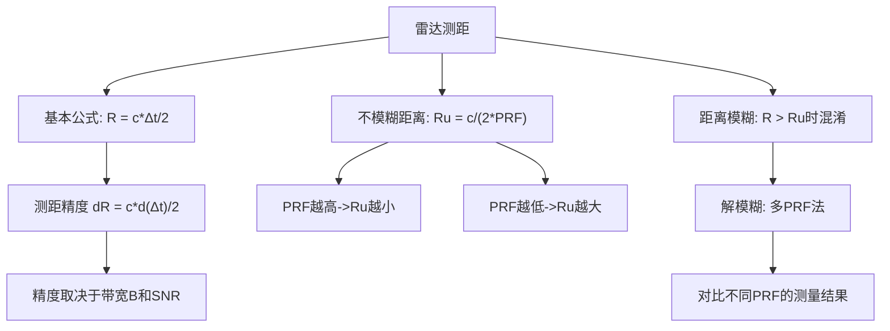

## 小节概述

雷达最基本的功能是测量目标到雷达的距离。这一测量的物理基础是电磁波在空间中以有限速度（光速）传播的事实。雷达发射一个脉冲信号，该信号以光速传播到目标，被目标反射后沿原路径返回，被雷达接收机捕获。通过精确测量脉冲从发射到接收的**往返时间**(Round-trip Time)，就可以计算出目标的距离。

然而，脉冲雷达并非可以无限地测量远距离目标。由于雷达以固定的重复频率发射脉冲，当目标距离过远时，其回波可能落在下一个发射脉冲之后，导致雷达无法判断该回波对应哪一个发射脉冲，从而产生**距离模糊**(Range Ambiguity)。定义最大不模糊距离(Maximum Unambiguous Range)是理解和设计脉冲雷达的关键。

## 关键知识点

### 一、基本测距原理

电磁波以光速 $c = 3 \times 10^8$ m/s 在空间中传播。当雷达发射一个脉冲信号后，它需要传播到目标再返回雷达，总传播距离为 $2R$（往返）。设脉冲往返时间为 $\Delta t$，则距离 $R$ 与时间 $\Delta t$ 之间的关系为：

$$
2R = c \cdot \Delta t
$$

因此目标的距离为：

$$
R = \frac{c \cdot \Delta t}{2}
$$

这个关系式的物理含义是：
1. 比例系数1/2来源于往返路径（去程和回程）
2. $c$ 是自然界的基本常数，在自由空间中恒定
3. 因此测距的精度完全取决于计时精度 $\delta(\Delta t)$

**测距精度分析**：测距误差 $\delta R$ 与时间测量误差 $\delta(\Delta t)$ 成正比：

$$
\delta R = \frac{c}{2} \cdot \delta(\Delta t)
$$

时间测量误差 $\delta(\Delta t)$ 取决于信号带宽 $B$ 和信噪比 $SNR$。带宽越宽、信噪比越高，测距越精确。

### 二、不模糊距离

脉冲雷达以固定的脉冲重复频率 $PRF$ 发射脉冲，相邻脉冲之间的时间间隔为 $PRI = 1/PRF$。雷达在每个 $PRI$ 周期内只能处理一个回波——如果某个目标的回波在下一个脉冲发射之后才到达，雷达将误认为该回波属于新的脉冲，从而得出错误的目标距离。

**推导过程**：设最大可处理的时延为 $PRI$，则对应的最大不模糊距离为：

$$
R_u = \frac{c \cdot PRI}{2} = \frac{c}{2 \cdot PRF}
$$

这个公式表明：
- $PRF$ 越高（脉冲越密集），不模糊距离 $R_u$ 越小
- $PRF$ 越低（脉冲越稀疏），不模糊距离 $R_u$ 越大

**举例说明**：若 $PRF = 1$ kHz，则 $PRI = 1$ ms，不模糊距离为：

$$
R_u = \frac{3 \times 10^8}{2 \times 1000} = 150,000 \text{ m} = 150 \text{ km}
$$

若 $PRF = 10$ kHz，则 $R_u = 15$ km。

### 三、距离模糊的物理含义

当目标距离 $R > R_u$ 时，回波时延 $\Delta t > PRI$。雷达记录的实际时延为 $\Delta t' = \Delta t - PRI$（取模运算），导致测量的视在距离为：

$$
R_{apparent} = \frac{c \cdot \Delta t'}{2} < R_u
$$

这意味着实际距离为 $150$ km 的目标，在 $PRF=1$ kHz时会被误认为 $0$ km 的目标。这种现象称为**距离模糊**(Range Ambiguity)。

**解模糊方法**：使用多个不同的PRF交替发射，通过对比不同PRF下的测量结果恢复真实距离。这是脉冲多普勒雷达的常用技术。

### 四、距离门(Range Gate)

为了在接收机中分辨不同距离的回波，雷达将每个 $PRI$ 划分为多个**距离门**(Range Gate)。每个距离门对应一段距离区间，宽度通常等于距离分辨率 $\Delta R$。距离门数 $N_g = R_u / \Delta R$。

## 知识结构

## 关键术语

| 英文 | 中文 | 解释 |
|------|------|------|
| Range | 距离 | 雷达到目标的直线距离 |
| Round-trip Time | 往返时间 | 脉冲从发射到接收的时间差 |
| Unambiguous Range | 最大不模糊距离 | 无距离模糊的最大可测距离 |
| Range Ambiguity | 距离模糊 | 远距目标被误认为近距的现象 |
| Range Gate | 距离门 | 距离维的最小分辨单元 |
| PRF (Pulse Repetition Frequency) | 脉冲重复频率 | 每秒发射的脉冲数 |
| PRI (Pulse Repetition Interval) | 脉冲重复间隔 | 相邻脉冲的时间间隔 |
