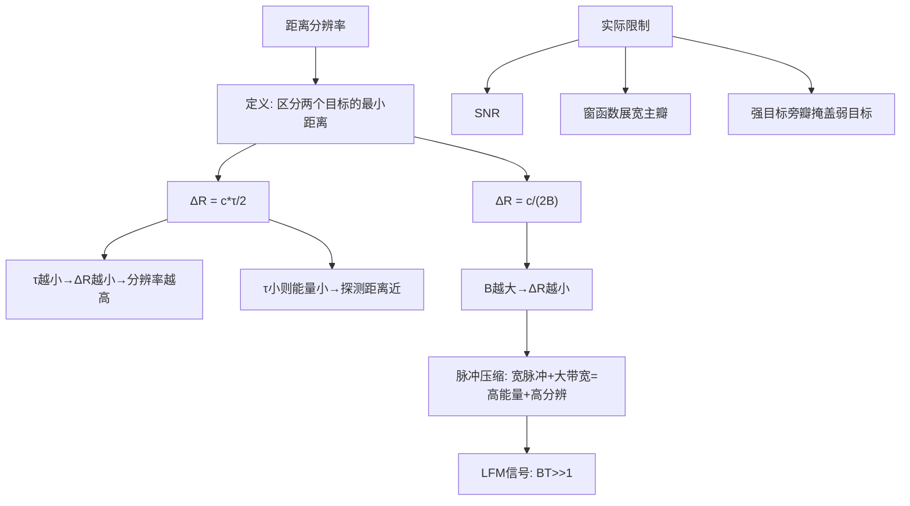

## 小节概述

距离分辨率(Range Resolution)是雷达最重要的性能指标之一，它定义了雷达能够区分两个相邻目标的最小距离间隔。如果两个目标靠得太近，它们的回波在时间上会重叠，雷达将无法分辨它们是两个独立的目标。

理解距离分辨率的关键在于认识到它直接由发射脉冲的宽度 $\tau$ 决定，而脉冲宽度又决定了信号的带宽 $B$。对于未调制的简单脉冲，脉冲宽度 $\tau$ 和带宽 $B$ 之间存在近似关系 $B \approx 1/\tau$。因此，距离分辨率最终取决于信号的带宽——这一认识是脉冲压缩技术的理论基础。

## 关键知识点

### 一、距离分辨率的定义

考虑两个位于不同距离 $R_1$ 和 $R_2$ 的目标，其回波到达雷达的时间差为：

$$
\Delta t = \frac{2(R_2 - R_1)}{c}
$$

要使雷达能够区分这两个目标，它们回波的时间差必须至少等于脉冲宽度 $\tau$（一个脉冲完全离开目标后另一个脉冲才能被分辨），即：

$$
\Delta t \geq \tau \quad \Rightarrow \quad \frac{2\Delta R}{c} \geq \tau
$$

因此距离分辨率为：

$$
\boxed{\Delta R = \frac{c \tau}{2}}
$$

### 二、分辨率与带宽的关系

对于未调制的矩形脉冲，其频谱为sinc函数形状，信号的有效带宽近似为：

$$
B \approx \frac{1}{\tau}
$$

代入距离分辨率公式得到另一个等价形式：

$$
\boxed{\Delta R = \frac{c}{2B}}
$$

**这个等式的物理意义极其重要**：它说明距离分辨率完全由信号的带宽 $B$ 决定，与脉冲宽度 $\tau$ 没有直接关系。这意味着我们可以通过以下方式提高距离分辨率：
1. 减小脉冲宽度 $\tau$（简单方法，但会导致发射能量降低）
2. 增大信号带宽 $B$（通过脉冲压缩技术，保持脉冲能量不变的同时增大带宽）

### 三、工程含义和举例

考虑不同典型脉冲宽度对应的距离分辨率（假设为简单矩形脉冲）：

| 脉冲宽度 $\tau$ | 带宽 $B$ | 距离分辨率 $\Delta R$ | 应用场景 |
|:---:|:---:|:---:|:---|
| 0.1 $\mu$s | 10 MHz | 15 m | 高分辨率雷达 |
| 1 $\mu$s | 1 MHz | 150 m | 常规火控雷达 |
| 10 $\mu$s | 100 kHz | 1.5 km | 远程监视雷达 |
| 100 $\mu$s | 10 kHz | 15 km | 早期预警雷达 |

从表中可以看出，要提高距离分辨率，有两种途径：
1. **直接缩短脉冲宽度**：这将降低脉冲能量，缩短探测距离
2. **保持脉宽不变、增大带宽**：这就是脉冲压缩技术——发射长脉冲（大能量）但要调制（大带宽），接收时通过匹配滤波压缩成短脉冲

### 四、实际分辨率的限制

实际中，距离分辨率还受到以下因素影响：
- **信噪比(SNR)**：低SNR下分辨能力下降
- **加权窗函数**：为了压低旁瓣而展宽主瓣，降低分辨率
- **目标间互作用**：强目标和弱目标之间，旁瓣可能掩盖邻近的弱目标

## 知识结构

## 关键术语

| 英文 | 中文 | 解释 |
|------|------|------|
| Range Resolution | 距离分辨率 | 区分两个相邻目标的最小距离间隔 |
| Pulse Width $\tau$ | 脉冲宽度 | 发射脉冲的持续时间(s) |
| Signal Bandwidth $B$ | 信号带宽 | 信号占用的频率范围(Hz) |
| Pulse Compression | 脉冲压缩 | 宽脉冲配合大带宽实现高分辨的技术 |
| Matched Filter | 匹配滤波器 | 最大化输出SNR的最优接收滤波器 |
| Range Sidelobe | 距离旁瓣 | 脉冲压缩后距离向上的虚假响应 |
