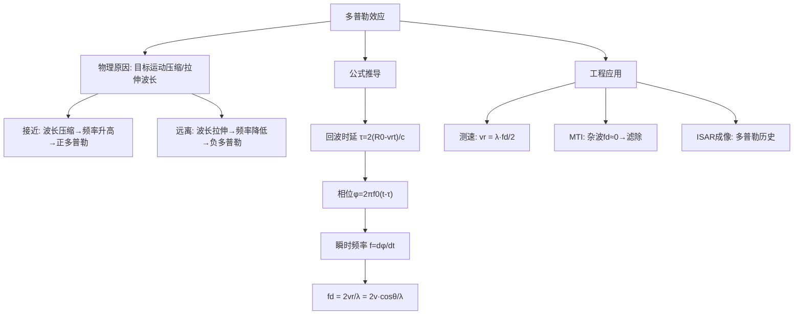

## 小节概述

多普勒效应(Doppler Effect)是雷达探测运动目标的物理基础。当目标相对于雷达运动时，接收到的回波信号频率与发射信号频率之间存在差异，这个频率差异称为多普勒频率(Doppler Frequency)。多普勒频率的大小正比于目标的径向速度，方向取决于目标是靠近雷达还是远离雷达。

多普勒效应在雷达中有两个最重要的应用：
1. **测速**：通过测量多普勒频率计算目标的速度
2. **动目标检测(MTI)**：利用静止杂波的多普勒频率为零的特性将其与运动目标区分开

本节将从电磁波传播的基本原理出发，详细推导多普勒频率的公式，并解释其物理含义。

## 关键知识点

### 一、多普勒效应的物理原理

当雷达与目标之间存在相对运动时，回波信号的波长被[压缩"或"拉伸"，导致频率发生变化。这个现象的直观理解如下：

- **目标接近雷达(Closing Target)**：回波波长被压缩，频率升高，多普勒频移为正
- **目标远离雷达(Opening Target)**：回波波长被拉伸，频率降低，多普勒频移为负

多普勒频移的大小与目标的**径向速度**(Radial Velocity)成正比。径向速度是目标速度矢量在雷达视线方向上的投影分量。

### 二、多普勒频率公式的完整推导

**步骤1：发射信号模型**

设雷达发射的单频连续波信号为：

$$
s(t) = A \cos(2\pi f_0 t)
$$

其中 $f_0$ 是发射频率。

**步骤2：计算回波时延**

目标初始距离为 $R_0$，以径向速度 $v_r$ 运动。在时刻 $t$，目标的瞬时距离为：

$$
R(t) = R_0 - v_r t
$$

这里约定：$v_r > 0$ 表示目标接近雷达（距离减小），$v_r < 0$ 表示目标远离雷达。

电磁波往返一次的总传播距离为 $2R(t)$，因此回波信号在时刻 $t$ 的时延为：

$$
\tau(t) = \frac{2R(t)}{c} = \frac{2(R_0 - v_r t)}{c}
$$

**步骤3：分析回波相位**

时刻 $t$ 接收到的回波信号实际上是在更早时刻 $t - \tau(t)$ 发射的，因此接收信号的表达式为：

$$
s_r(t) = A_r \cos\left[2\pi f_0 (t - \tau(t))\right]
$$

代入时延 $\tau(t)$：

$$
s_r(t) = A_r \cos\left[2\pi f_0 t - \frac{4\pi f_0}{c}(R_0 - v_r t)\right]
$$

将相位项展开：

$$
\phi(t) = 2\pi f_0 t - \frac{4\pi f_0 R_0}{c} + \frac{4\pi f_0 v_r}{c} t
$$

合并与 $t$ 相关的项：

$$
\phi(t) = 2\pi\left(f_0 + \frac{2v_r f_0}{c}\right) t - \frac{4\pi f_0 R_0}{c}
$$

**步骤4：求瞬时频率**

瞬时频率是相位对时间的导数：

$$
f = \frac{1}{2\pi} \frac{d\phi(t)}{dt} = f_0 + \frac{2v_r f_0}{c}
$$

**步骤5：多普勒频移**

接收频率与发射频率的差值即为多普勒频移：

$$
f_d = f - f_0 = \frac{2v_r f_0}{c}
$$

利用波长 $\lambda = c/f_0$，得到最常用的形式：

$$
\boxed{f_d = \frac{2v_r}{\lambda}}
$$

其中径向速度 $v_r = v \cos\theta$，$v$ 为目标速度矢量大小，$\theta$ 为目标视线与速度矢量之间的夹角。

### 三、多普勒频率的方向特性

- **接近目标**($v_r > 0$)：$f_d > 0$，回波频率高于发射频率
- **远离目标**($v_r < 0$)：$f_d < 0$，回波频率低于发射频率

$$
\boxed{f_d = \frac{2v}{\lambda} \cos\theta}
\quad\text{其中}\quad
\theta = 0^\circ \rightarrow f_d = \frac{2v}{\lambda} \text{(最大正多普勒)}
$$
$$
\theta = 180^\circ \rightarrow f_d = -\frac{2v}{\lambda} \text{(最大负多普勒)}
$$
$$
\theta = 90^\circ \rightarrow f_d = 0 \text{(无多普勒，目标切向运动)}
$$

### 四、数值示例

设雷达工作在X波段，频率 $f_0 = 10$ GHz（波长 $\lambda = 3$ cm），目标以 $v = 300$ m/s 的速度径向接近：

$$
f_d = \frac{2 \times 300}{0.03} = 20,000 \text{ Hz} = 20 \text{ kHz}
$$

这个多普勒频移相对于10 GHz的载频来说非常小（约为载频的百万分之二），但完全可以通过相干检波技术测量出来。

### 五、时间膨胀因子

除了频率偏移外，目标运动还会导致脉冲宽度发生变化，称为时间膨胀(Time Dilation)：

$$
\frac{\tau'}{\tau} = \frac{c + v_r}{c - v_r} \quad\text{(远离目标)}
$$
$$
\frac{\tau'}{\tau} = \frac{c - v_r}{c + v_r} \quad\text{(接近目标)}
$$

在常规雷达中，由于 $v_r \ll c$，时间膨胀效应非常微弱，通常忽略不计。但对于超高速目标（如弹道导弹、卫星），这一效应不可忽略。

## 知识结构

## 关键术语

| 英文 | 中文 | 解释 |
|------|------|------|
| Doppler Effect | 多普勒效应 | 相对运动引起频率变化的物理现象 |
| Doppler Frequency $f_d$ | 多普勒频率 | 回波与发射信号的频率差 |
| Radial Velocity $v_r$ | 径向速度 | 目标速度在雷达视线方向的分量 |
| Closing Target | 接近目标 | 向雷达方向运动的目标($f_d > 0$) |
| Opening Target | 远离目标 | 远离雷达方向的目标($f_d < 0$) |
| Time Dilation | 时间膨胀 | 目标运动引起的脉冲宽度变化 |
| Coherent Detection | 相干检波 | 保留相位信息的多普勒测量方法 |
