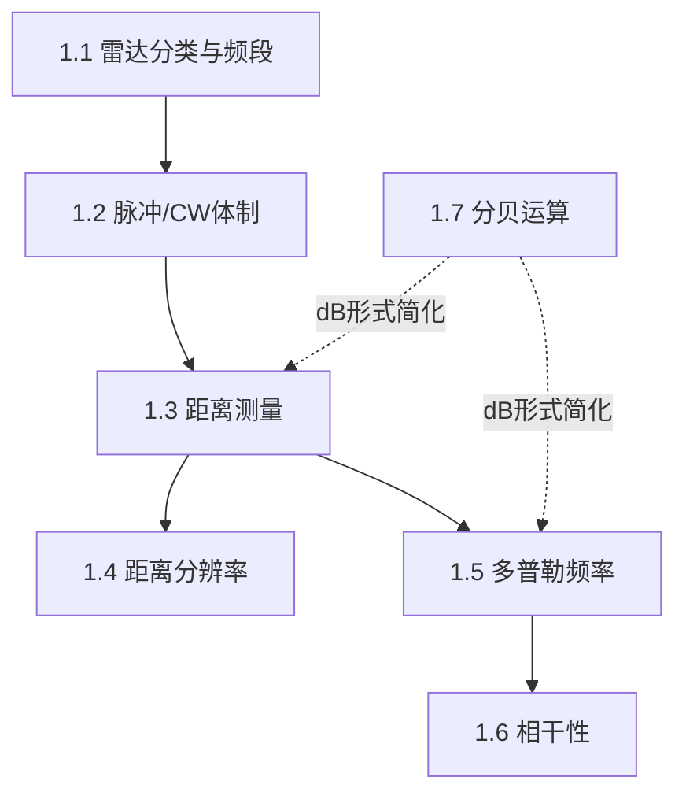

## 章节概述
本章奠定雷达系统的基本概念和术语体系，包括雷达分类、工作频段、脉冲/CW体制、距离方程基本参数、多普勒效应等基础概念。

## 小节间联系

- §1.1-1.2 为雷达系统的基础分类知识
- §1.3-1.5 为雷达三个基本测量维度：距离、分辨率、速度
- §1.6 决定雷达能否进行多普勒处理
- §1.7 提供贯穿全书的数量级简化工具

## 关键术语

| 英文 | 中文 | 解释 |
|------|------|------|
| Range | 距离 | 雷达到目标的直线距离 |
| Range Resolution | 距离分辨率 | 区分两个相邻目标的最小间距 |
| Doppler Frequency | 多普勒频率 | 目标运动引起的回波频率偏移 |
| Pulse Repetition Frequency (PRF) | 脉冲重复频率 | 每秒发射的脉冲数 |
| Pulse Repetition Interval (PRI) | 脉冲重复间隔 | 相邻脉冲的时间间隔 |
| Pulse Width | 脉冲宽度 | 单个脉冲的持续时间 |
| Coherence | 相干性 | 信号相位信息的保留程度 |
| Unambiguous Range | 最大不模糊距离 | 无距离模糊的最大可测距离 |
| Decibel (dB) | 分贝 | 功率比的对数表示 |
| Band | 频段 | 雷达工作频率的划分区间 |

## 章节总结
本章为全书的基础，定义了雷达系统的核心术语和基本概念。重点掌握：
1. 雷达距离测量的基本公式 $$R = c\cdot\Delta t/2$$
2. 距离分辨率与脉宽的关系 $$\Delta R = c\cdot\tau/2$$
3. 多普勒频率公式 $$f_d = 2v\cos\theta/\lambda$$
4. 分贝运算在雷达方程中的应用
