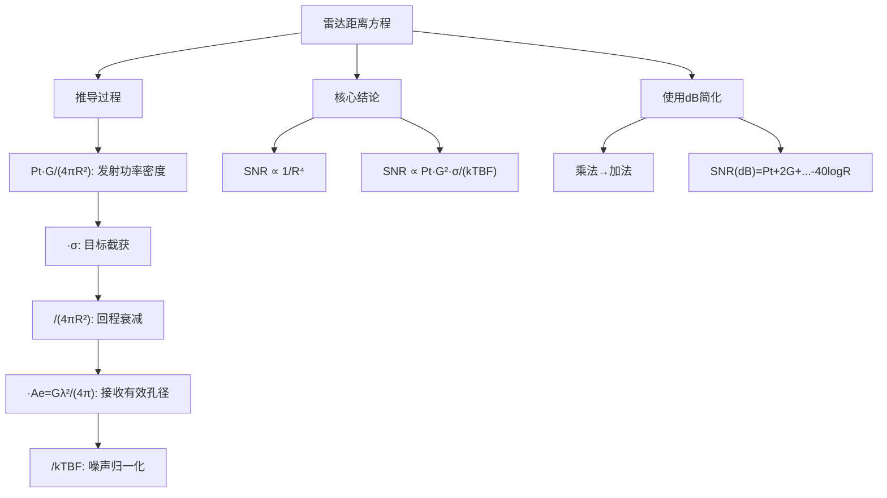

## 小节概述

雷达距离方程(Radar Range Equation)是雷达系统设计中最基本也是最重要的方程。它将接收到的回波信号功率与发射功率、天线特性、目标特性、传播距离和系统噪声等所有关键参数联系在一起，为雷达系统的性能预测和设计提供了定量的数学工具。

理解雷达距离方程的关键在于：回波信号功率随距离的四次方衰减（$1/R^4$），这与通信系统中信号的平方衰减（$1/R^2$）有本质区别。这是因为雷达信号要经历[去程衰减×目标反射×回程衰减"的双重路径损耗。同时，雷达方程采用对数(dB)形式可以大大简化计算。

## 关键知识点

### 一、基本雷达距离方程的推导

**步骤1：发射功率密度**

雷达发射机产生峰值功率 $P_t$ [W]，通过天线辐射到空间。假设天线是各向同性辐射器，则在距离 $R$ 处的功率密度为：

$$
S_{iso} = \frac{P_t}{4\pi R^2}
$$

实际雷达使用定向天线，其增益为 $G$，因此目标方向上的功率密度为：

$$
S_{dir} = \frac{P_t G}{4\pi R^2}
$$

增益 $G$ 定义为定向天线的辐射强度与各向同性天线的辐射强度之比，通常用dBi表示。

**步骤2：目标截获和再辐射**

目标截获入射功率，其等效截获面积为雷达截面积(RCS) $\sigma$ [m²]，因此目标截获的总功率为：

$$
P_{int} = \frac{P_t G}{4\pi R^2} \cdot \sigma
$$

目标将截获的功率各向同性地再辐射出去。注意：RCS是一个等效面积，它并不是目标的物理截面积，而是使目标回波功率等于该面积截获功率的等效值。

**步骤3：回波功率到达接收机**

目标再辐射的功率传播回雷达，在雷达处再次经历 $1/(4\pi R^2)$ 的扩散衰减。因此接收天线处的功率密度为：

$$
S_{rx} = \frac{P_{int}}{4\pi R^2} = \frac{P_t G \sigma}{(4\pi)^2 R^4}
$$

**步骤4：接收天线有效孔径**

接收天线收集电磁波能量的能力由有效孔径 $A_e$ 决定。天线增益与有效孔径的关系为：

$$
G = \frac{4\pi A_e}{\lambda^2} \quad \Rightarrow \quad A_e = \frac{G\lambda^2}{4\pi}
$$

因此接收到的信号功率为：

$$
P_r = S_{rx} \cdot A_e = \frac{P_t G \sigma}{(4\pi)^2 R^4} \cdot \frac{G\lambda^2}{4\pi} = \frac{P_t G^2 \lambda^2 \sigma}{(4\pi)^3 R^4}
$$

**步骤5：引入噪声和损耗**

接收机中的热噪声功率为：

$$
N = k T_0 B F
$$

其中：
- $k = 1.38 \times 10^{-23}$ J/K：玻尔兹曼常数
- $T_0 = 290$ K：标准参考温度
- $B$：接收机带宽 [Hz]
- $F$：噪声系数（接收机引入额外噪声的度量）

**步骤6：最终信噪比表达式**

考虑系统总损耗 $L$，信噪比 SNR 为：

$$
\boxed{SNR = \frac{P_t G^2 \lambda^2 \sigma}{(4\pi)^3 R^4 k T_0 B F L}}
$$

这个方程可以改写为dB形式，使乘除运算变为加减：

$$
SNR_{dB} = P_{t,dB} + 2G_{dB} + 10\log_{10}(\lambda^2) + 10\log_{10}(\sigma) - 10\log_{10}((4\pi)^3) - 10\log_{10}(k) - 10\log_{10}(T_0) - 10\log_{10}(B) - F_{dB} - L_{dB} - 40\log_{10}(R)
$$

### 二、SNR与距离的四次方关系

方程中最重要的特征是 $SNR \propto 1/R^4$。这意味着：

- 距离增加一倍，SNR下降 $20\log_{10}(2^4) = 12$ dB
- 要使探测距离增加一倍，需要将发射功率提高16倍（在保持其他参数不变的情况下）

这个四次方关系是雷达系统设计面临的根本挑战之一。

### 三、各参数的单位和典型取值范围

| 参数 | 符号 | 典型单位 | 典型取值 |
|------|------|---------|---------|
| 峰值功率 | $P_t$ | W | 1 kW - 1 MW |
| 天线增益 | $G$ | dB | 20-50 dB |
| 波长 | $\lambda$ | m | 0.01-1 m |
| RCS | $\sigma$ | m²或dBsm | 0.01-100 m² |
| 距离 | $R$ | m或km | 1-1000 km |
| 带宽 | $B$ | Hz | 1-100 MHz |
| 噪声系数 | $F$ | dB | 1-10 dB |

## 代码段

```matlab
function [snr] = radar_eq(pt, freq, g, sigma, b, nf, loss, range)
%% radar_eq - 雷达距离方程(公式2.22)
% 计算不同距离下的信噪比SNR
c = 3.0e+8;                    % 光速 [m/s]
lambda = c / freq;              % 波长 [m]
% 将所有参数转换为dB
p_peak_db = 10*log10(pt);      % 峰值功率 [dB]
lambda_sqdb = 10*log10(lambda^2);
sigmadb = 10*log10(sigma);
four_pi_cub = 10*log10((4*pi)^3);
k_db = 10*log10(1.38e-23);     % 玻尔兹曼常数 [dB]
to_db = 10*log10(290);          % 噪声温度 [dB]
b_db = 10*log10(b);
range_pwr4_db = 10*log10(range.^4);  % R^4 [dB]
num = p_peak_db + 2*g + lambda_sqdb + sigmadb;
den = four_pi_cub + k_db + to_db + b_db + nf + loss + range_pwr4_db;
snr = num - den;
end
```

## 知识结构



## 关键术语

| 英文 | 中文 | 解释 |
|------|------|------|
| Radar Range Equation | 雷达距离方程 | 描述SNR与各参数的定量关系 |
| Signal-to-Noise Ratio | 信噪比 | 信号功率与噪声功率之比(dB) |
| Peak Power $P_t$ | 峰值功率 | 发射脉冲期间的瞬时功率(W) |
| Antenna Gain $G$ | 天线增益 | 定向天线相对于各向同性的增益(dB) |
| Radar Cross Section $\sigma$ | 雷达截面积 | 目标散射能力的等效面积(m²) |
| Boltzmann Constant $k$ | 玻尔兹曼常数 | 1.38×10⁻²³ J/K |
| Noise Figure $F$ | 噪声系数 | 接收机引入额外噪声的度量(dB) |
