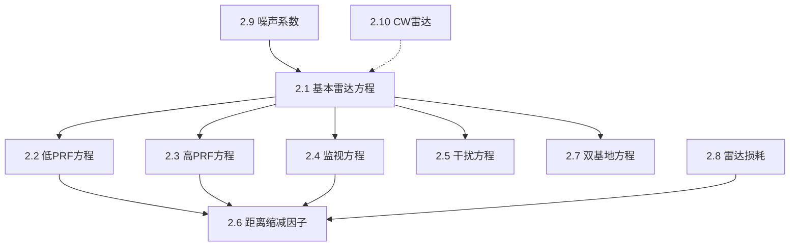

## 章节概述
本章是全书最重要的章节之一，系统推导了雷达距离方程及其各种变体，包括低PRF、高PRF、监视雷达、干扰条件下的雷达方程，以及CW雷达的基本原理。

## 小节间联系

- §2.1 是核心，所有后续方程都是其变体
- §2.2-2.5 展示了不同工作模式下的方程形式
- §2.6-2.9 提供了方程中的修正因子
- §2.10 扩展到连续波体制

## 关键术语

| 英文 | 中文 | 解释 |
|------|------|------|
| Radar Range Equation | 雷达距离方程 | 描述SNR与各参数的定量关系 |
| SNR (Signal-to-Noise Ratio) | 信噪比 | 信号功率与噪声功率之比 |
| Power-Aperture Product | 功率孔径积 | 平均功率与有效孔径的乘积 |
| Self-Screening Jammer (SSJ) | 自屏蔽干扰机 | 装在目标上的干扰机 |
| Burn-through Range | 烧穿距离 | 信号功率超过干扰功率的最小距离 |
| Stand-off Jammer (SOJ) | 远距离干扰机 | 远离目标的支援干扰机 |
| Noise Figure | 噪声系数 | 接收机引入额外噪声的度量 |
| Bistatic Radar | 双基地雷达 | 收发分置的雷达系统 |
| LFM (Linear Frequency Modulation) | 线性调频 | 频率随时间线性变化的信号 |
| Cross-over Loss | 交叉损耗 | CW雷达收发隔离的损耗 |

## 章节总结
本章是雷达系统设计的核心内容。重点掌握：
1. 基本雷达距离方程的推导和应用
2. 不同工作模式(低PRF/高PRF/监视)的方程差异
3. 干扰环境下的性能评估(SSJ/SOJ/Burn-through)
4. 损耗和噪声系数的处理
5. CW雷达的频率调制测距原理
