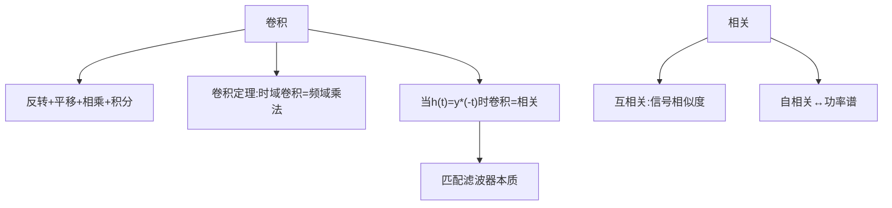

## 小节概述
卷积(Convolution)和相关(Correlation)是信号处理中最基本的运算。卷积用于计算LTI系统对输入信号的响应，相关用于度量信号间的相似程度。在雷达中，互相关是匹配滤波器的数学本质——这是雷达最优检测的理论基础。两者的共同特征是[滑动相乘再求和"。

## 关键知识点

### 一、卷积的定义与物理含义

$$
y(t)=x(t)*h(t)=\int_{-\infty}^{\infty}x(\tau)h(t-\tau)d\tau
$$

**计算步骤**：
1. 反转：将h(τ)反转为h(-τ)
2. 平移：平移到t时刻得h(t-τ)
3. 相乘：x(τ)·h(t-τ)逐点相乘
4. 积分：沿τ轴积分得到t时刻的输出
5. 遍历：对所有t重复

**物理含义**：系统在t时刻的输出是输入信号在全部历史时刻的加权和，权重由冲激响应决定。

### 二、卷积定理

$$
x(t)*h(t)\leftrightarrow X(f)\cdot H(f)
$$

含义：时域卷积等价于频域乘法。这是FFT快速实现匹配滤波器的理论基础。

### 三、相关的定义与物理含义

互相关：$$R_{xy}(\tau)=\int x(t)y^*(t-\tau)dt$$
自相关：$$R_x(\tau)=\int x(t)x^*(t-\tau)dt$$

**物理含义**：相关度量了两个信号在不同相对时延下的相似程度。当信号完全匹配时，相关达到最大值。

### 四、卷积与相关的关系

当h(t)=y*(-t)（匹配滤波器）时：x(t)*y*(-t)=Rxy(t)

这正是匹配滤波器的本质：冲激响应是发射信号的时间反转共轭，输出是发射信号与回波的互相关。

### 五、维纳-辛钦定理

能量信号：Rx(τ)↔|X(f)|²
功率信号：Rx(τ)↔Sx(f)（功率谱密度）

## 知识结构

## 关键术语
|英文|中文|解释|
|----|----|----|
|Convolution|卷积|LTI系统输出的基本运算|
|Correlation|相关|信号相似程度的度量|
|Convolution Theorem|卷积定理|时域卷积=频域乘法|
|Matched Filter|匹配滤波器|h(t)=s*(t0-t)的最优滤波器|
|Wiener-Khinchin Theorem|维纳-辛钦定理|自相关↔功率谱密度|
