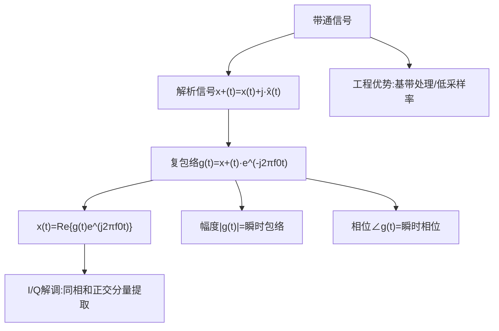

## 小节概述
带通信号(Bandpass Signal)是雷达和通信系统中实际传输的信号形式。为了分析和处理的方便，通常将带通信号等效为一个复包络(Complex Envelope)，从而将带通问题转化为低通问题。这种转换是雷达接收机I/Q解调和数字信号处理的理论基础。理解复包络的关键在于：它将信号的全部信息（幅度和相位调制）压缩在一个复低通信号中，载频信息被分离出去。

## 关键知识点

### 一、解析信号(Pre-Envelope)

实带通信号x(t)的解析信号定义为：

$$
x_+(t)=x(t)+j\hat{x}(t)
$$

其中 $\hat{x}(t)$ 是 $x(t)$ 的希尔伯特变换(Hilbert Transform)：

$$
\hat{x}(t)=
\frac{1}{\pi}\int_{-\infty}^{\infty}
\frac{x(\tau)}{t-\tau}d\tau=x(t)*
\frac{1}{\pi t}
$$

**重要性质**：解析信号的频谱只有正频率分量，是实信号频谱的正频率部分乘以2后的结果。

### 二、复包络表示

将解析信号x+(t)的载频分量下变频到基带：

$$
g(t)=x_+(t)e^{-j2\pi f_0 t}
$$

则原始带通信号可恢复为：

$$
x(t)=\text{Re}\{g(t)e^{j2\pi f_0 t}\}
$$

复包络g(t)包含了信号的全部信息：
- |g(t)| = 信号的瞬时包络
- ∠g(t) = 信号的瞬时相位
- d[∠g(t)]/dt = 信号的瞬时频率偏移

### 三、I/Q解调的实现

从复包络的表达式可以看出，要提取g(t)需要同时提取同相(I)和正交(Q)分量：

$$
g(t)=g_I(t)+jg_Q(t)
$$

在雷达接收机中，这通过将接收信号分别与cos(2πf0t)和-sin(2πf0t)混频来实现：
- I通道：x(t)·cos(2πf0t)→低通滤波→gI(t)
- Q通道：x(t)·[-sin(2πf0t)]→低通滤波→gQ(t)

### 四、工程意义

复包络表示极大地简化了雷达信号处理：
1. 采样率要求：处理复包络只需要处理基带信号，采样率由信号带宽B决定（fs≥B），而非载频
2. 匹配滤波器：对带通信号的匹配滤波可等效为对复包络进行匹配滤波
3. 多普勒处理：复包络自然包含了相位信息，支撑多普勒频率的提取

## 知识结构

## 关键术语
|英文|中文|解释|
|----|----|----|
|Bandpass Signal|带通信号|频谱集中在载频附近的实信号|
|Analytic Signal|解析信号|去除负频率分量的复信号|
|Complex Envelope|复包络|带通信号的等效基带表示|
|Hilbert Transform|希尔伯特变换|产生90°相移的线性变换|
|I/Q Demodulation|I/Q解调|提取同相和正交分量的过程|
