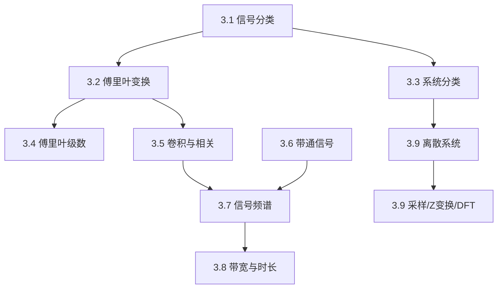

## 章节概述
本章回顾信号与系统的基础理论，为雷达信号处理建立数学框架。涵盖信号分类、傅里叶变换、线性系统、卷积/相关、带通信号、离散时间系统等内容。

## 小节间联系

- 前五节为连续信号处理基础
- §3.6 带通信号表示是雷达信号处理的关键
- §3.7-3.8 将理论应用于实际雷达信号
- §3.9 建立离散处理的桥梁

## 关键术语

| 英文 | 中文 | 解释 |
|------|------|------|
| Fourier Transform | 傅里叶变换 | 时域-频域转换工具 |
| Convolution | 卷积 | 线性系统输出计算 |
| Correlation | 相关 | 信号相似性度量 |
| Analytic Signal | 解析信号 | 去除负频率的复信号 |
| Complex Envelope | 复包络 | 带通信号的低通等效表示 |
| Hilbert Transform | 希尔伯特变换 | 产生90°相移 |
| Sampling Theorem | 采样定理 | 离散化的频率约束 |
| Z-Transform | Z变换 | 离散信号的频域分析 |
| DFT | 离散傅里叶变换 | DFT的离散实现 |

## 章节总结
本章为雷达信号处理的理论基础。重点掌握：
1. 傅里叶变换及卷积定理在雷达中的应用
2. 带通信号的复包络表示（后续所有处理的基础）
3. 常见雷达信号的频谱特征
4. 采样定理和DFT在数字信号处理中的应用
