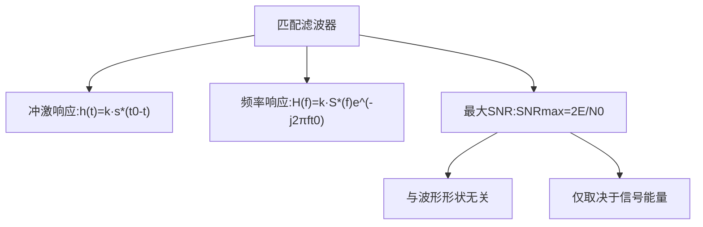

## 小节概述
匹配滤波器(Matched Filter)是在白噪声背景下最大化输出信噪比(SNR)的最优线性滤波器。它是雷达接收机的理论基础。匹配滤波器的冲激响应是发射信号的时间反转共轭：h(t)=k·s*(t0-t)。其最大输出SNR为SNRmax=2E/N0——仅取决于信号能量，与波形形状无关。这意味着：在给定能量下，任何波形都能达到相同的最大SNR。

## 关键知识点

### 一、匹配滤波器的最优性推导

**问题**：给定输入信号s(t)+n(t)（n(t)为白噪声，功率谱密度N0/2），寻找线性滤波器H(f)使输出在t0时刻的瞬时SNR最大。

**步骤1：输出信噪比表达式**

输出信号在t0时刻的瞬时功率为：

$$
|y_s(t_0)|^2 = \left|\int_{-\infty}^{\infty} H(f)S(f)e^{j2\pi ft_0}df
\right|^2
$$

输出噪声的平均功率为：

$$
E[|y_n(t)|^2] =
\frac{N_0}{2}\int_{-\infty}^{\infty} |H(f)|^2 df
$$

因此t0时刻的输出SNR为：

$$
SNR(t_0) =
\frac{|y_s(t_0)|^2}{E[|y_n|^2]} = 
\frac{\left|\int H(f)S(f)e^{j2\pi ft_0}df
\right|^2}{
\frac{N_0}{2}\int |H(f)|^2 df}
$$

**步骤2：应用施瓦茨不等式**

根据施瓦茨不等式：|∫A(f)B(f)df|² ≤ ∫|A(f)|²df · ∫|B(f)|²df

令A(f)=H(f)，B(f)=S(f)e^(j2πft0)，则当且仅当H(f)=k·B*(f)=k·S*(f)e^(-j2πft0)时取等号。

**步骤3：最大SNR**

代入最优H(f)：

$$
SNR_{max} =
\frac{\left|\int k|S(f)|^2 df
\right|^2}{
\frac{N_0}{2}\int |k S^*(f)e^{-j2\pi ft_0}|^2 df} = 
\frac{|k|^2\left[\int|S(f)|^2 df
\right]^2}{
\frac{N_0}{2}|k|^2\int|S(f)|^2 df} = 
\frac{2\int|S(f)|^2 df}{N_0} = 
\frac{2E}{N_0}
$$

其中E=∫|S(f)|²df=∫|s(t)|²dt是信号的能量，与波形无关。

### 二、结论的物理意义

SNRmax=2E/N0的三个重要含义：
1. 只取决于信号能量E，而不是信号的形状
2. 增加信号能量（提高发射功率或延长脉冲宽度）直接提高SNR
3. 对于给定的能量，任何波形都能获得相同的最大SNR

## 知识结构

## 关键术语
|英文|中文|解释|
|----|----|----|
|Matched Filter|匹配滤波器|最大化输出SNR的最优线性滤波器|
|White Noise|白噪声|功率谱密度恒定的噪声|
|Schwarz Inequality|施瓦茨不等式|确定最优性条件的数学工具|
|Signal Energy|信号能量|∫|s(t)|²dt=∫|S(f)|²df|
|Replica|副本|与发射信号完全相同的参考信号|
