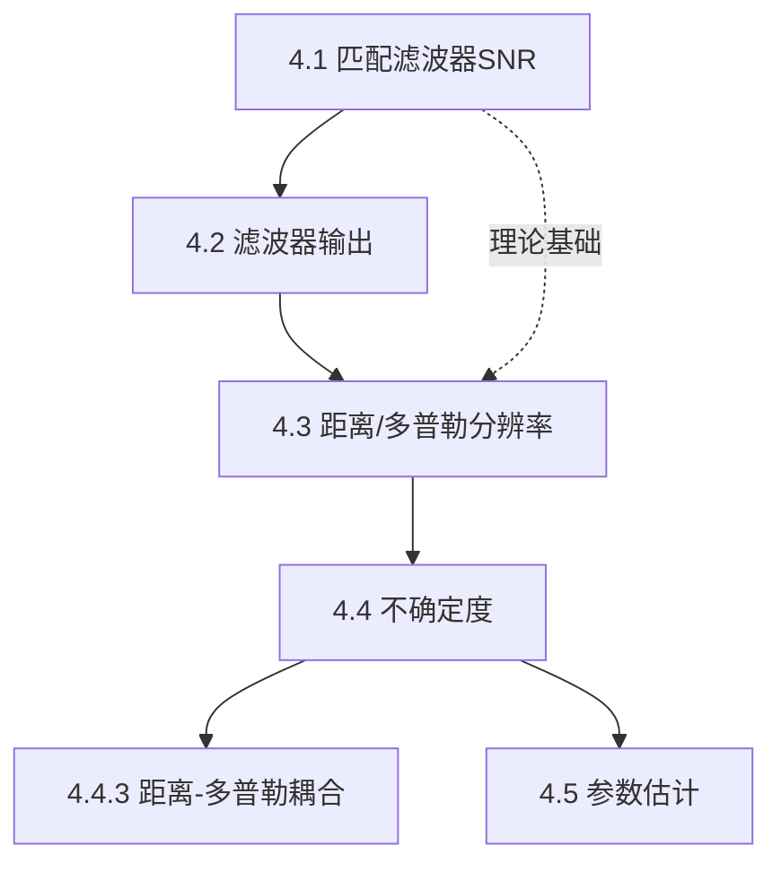

## 章节概述
本章介绍匹配滤波器理论——雷达接收机的最优信号处理准则。匹配滤波器在白噪声背景下最大化输出信噪比，是雷达检测的理论基础。

## 小节间联系

- §4.1 是核心理论，定义匹配滤波器
- §4.2 分析各种条件下的输出特性
- §4.3-4.4 讨论信号设计的根本矛盾——分辨率与模糊
- §4.5 扩展到参数估计问题

## 关键术语

| 英文 | 中文 | 解释 |
|------|------|------|
| Matched Filter | 匹配滤波器 | 最大化输出SNR的最优滤波器 |
| Replica | 副本 | 与发射信号匹配的参考信号 |
| Range Resolution | 距离分辨率 | 区分两个目标的距离最小间隔 |
| Doppler Resolution | 多普勒分辨率 | 区分两个目标的速度最小间隔 |
| Range-Doppler Coupling | 距离-多普勒耦合 | LFM信号中距离与速度的耦合效应 |
| Ambiguity | 模糊 | 测量值的不确定性 |
| Uncertainty Principle | 不确定原理 | 信号时宽与带宽的乘积约束 |

## 章节总结
本章是雷达信号设计的理论基础。重点掌握：
1. 匹配滤波器的冲激响应是发射信号的时间反转共轭
2. 最大输出SNR仅取决于信号能量和噪声功率谱密度
3. 距离分辨率取决于带宽，多普勒分辨率取决于时长
4. LFM信号的时宽带宽积很大，但存在距离-多普勒耦合
