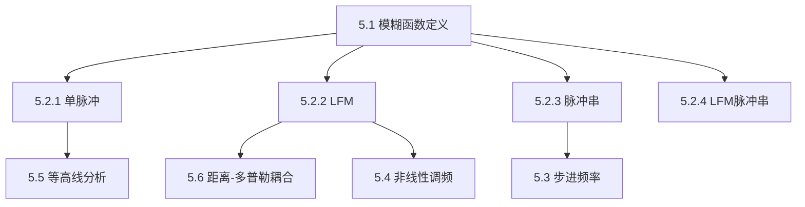

## 章节概述
本章系统介绍模糊函数理论，这是分析和比较雷达波形的核心工具。模糊函数描述雷达波形在不同时延和多普勒频移下的响应，决定其距离和速度分辨能力。

## 小节间联系

- §5.1 定义核心分析工具
- §5.2 展示4种基本波形的模糊函数特征
- §5.3-5.4 介绍高级波形设计
- §5.5-5.6 提供模糊图的解读方法

## 关键术语

| 英文 | 中文 | 解释 |
|------|------|------|
| Ambiguity Function | 模糊函数 | 波形距离-多普勒联合分辨特性的描述 |
| Range-Doppler Coupling | 距离-多普勒耦合 | LFM波形固有特性 |
| Coherent Pulse Train | 相干脉冲串 | 相位相干的多脉冲序列 |
| Stepped Frequency Waveform | 步进频率波形 | 频率步进合成大带宽 |
| Stationary Phase | 驻定相位 | 非线性调频设计方法 |
| Ambiguity Diagram | 模糊图 | 模糊函数的等高线表示 |
| Ridge | 刀刃 | LFM模糊函数的倾斜脊 |

## 章节总结
本章是波形设计的核心。重点掌握：
1. 模糊函数的定义和物理意义
2. 单脉冲产生[图钉"状模糊函数（理想）
3. LFM波形产生倾斜刀刃状模糊函数（实际常用）
4. 相干脉冲串产生周期性模糊峰
5. 步进频率波形合成大带宽
