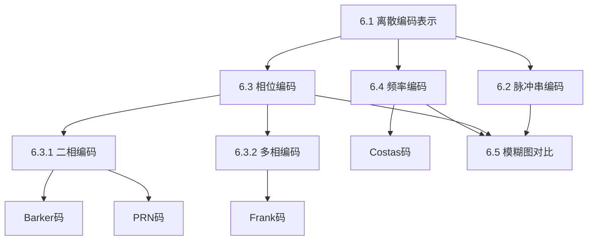

## 章节概述
本章研究离散编码波形的模糊函数特性，包括脉冲串编码、相位编码（Barker码、PRN码、Frank码）和频率编码（Costas码）。

## 小节间联系

- §6.1 建立离散编码的数学框架
- §6.2-6.4 介绍三大类编码技术
- §6.5 统一用模糊函数对比评估

## 关键术语

| 英文 | 中文 | 解释 |
|------|------|------|
| Barker Code | Barker码 | 二相编码，自相关旁瓣均匀为1 |
| PRN Code | 伪随机码 | 伪随机序列，近似白噪声特性 |
| Frank Code | Frank码 | 多相编码，多普勒容限好 |
| Costas Code | Costas码 | 频率跳变编码，二维分辨特性好 |
| LFSR | 线性反馈移位寄存器 | PRN序列生成器 |
| Polyphase Code | 多相编码 | 多相位级别的编码 |
| Autocorrelation Sidelobe | 自相关旁瓣 | 影响弱目标检测的干扰 |

## 章节总结
本章对比各类离散编码波形的模糊函数特性。重点掌握：
1. Barker码是最优二相码但最长仅13位
2. PRN码周期长、近似噪声特性
3. Frank码优于二相码的多普勒容限
4. Costas码在距离-多普勒二维分辨中表现优异
5. 编码波形选择需要在旁瓣水平、多普勒容限、实现复杂度间权衡
