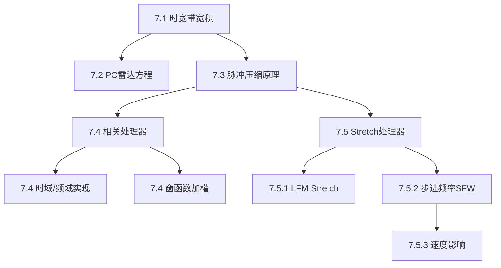

## 章节概述
脉冲压缩技术在保持高距离分辨率的同时利用长脉冲获得高能量，是雷达波形设计的核心工程方法。本章涵盖匹配滤波器处理、Stretch处理和步进频率波形三种实现方式。

## 小节间联系

- §7.1-7.3 建立脉冲压缩的理论基础
- §7.4 介绍经典相关处理器
- §7.5 介绍大带宽的高效处理方法

## 关键术语

| 英文 | 中文 | 解释 |
|------|------|------|
| Pulse Compression | 脉冲压缩 | 发射宽脉冲、接收压缩的处理技术 |
| Time-Bandwidth Product | 时宽带宽积 | 信号时长与带宽的乘积 |
| Compression Ratio | 压缩比 | 压缩前后脉宽之比 |
| Stretch Processor | Stretch处理器 | LFM大带宽的高效压缩方法 |
| De-ramp | 去斜 | Stretch处理中的混频操作 |
| Stepped Frequency Waveform | 步进频率波形 | 频率步进合成超大带宽 |
| Range Sidelobe | 距离旁瓣 | 脉冲压缩后距离维的虚假响应 |
| Correlation Processor | 相关处理器 | 通过相关运算实现脉冲压缩 |

## 章节总结
本章是波形设计的工程核心。重点掌握：
1. 脉冲压缩打破了距离分辨率对脉冲能量的限制
2. 压缩比等于时宽带宽积
3. 相关处理器和Stretch处理器的适用场景
4. SFW的合成带宽原理和距离模糊约束
