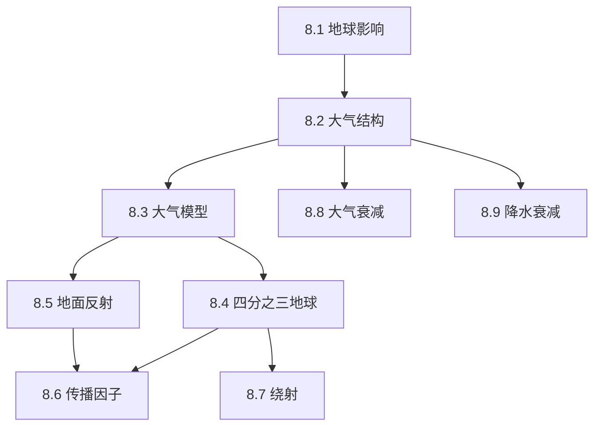

## 章节概述
本章研究电磁波在大气中传播时的各种效应对雷达性能的影响，包括大气折射、地波反射、多径传播、绕射和大气衰减等。

## 小节间联系

- §8.1-8.4 建立地球大气传播的几何和物理模型
- §8.5-8.7 讨论地面和障碍物引起的传播效应
- §8.8-8.9 量化大气介质引起的能量损耗

## 关键术语

| 英文 | 中文 | 解释 |
|------|------|------|
| Refraction | 折射 | 电磁波在介质中的弯曲 |
| Four-Third Earth Model | 四分之三地球模型 | 考虑折射的等效地球半径 |
| Divergence | 发散因子 | 球形地表反射波的几何扩散 |
| Diffraction | 绕射 | 电磁波越过障碍物的能力 |
| Multipath | 多径 | 多条传播路径的干涉 |
| Pattern Propagation Factor | 传播因子 | 描述多径干涉对方向图的影响 |
| Atmospheric Attenuation | 大气衰减 | 大气气体对电磁波的吸收 |
| Ducting | 波导传播 | 大气波导引起的超视距传播 |

## 章节总结
传播效应对雷达性能有显著影响。重点掌握：
1. 四分之三地球模型的等效处理
2. 多径传播的干涉图样及盲区
3. 大气衰减随频率和仰角的变化规律
4. 绕射对低仰角覆盖的扩展
