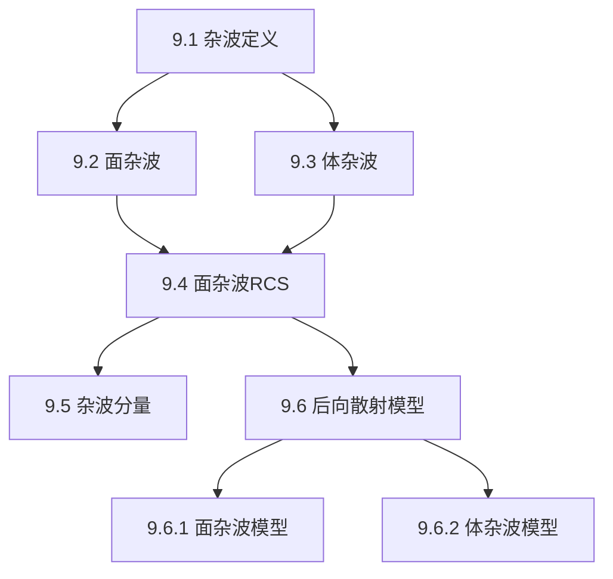

## 章节概述
杂波是雷达回波中的非目标信号，是限制雷达检测性能的主要因素。本章定义杂波类型、建立杂波RCS模型、介绍杂波后向散射系数的统计特性。

## 小节间联系

- §9.1-9.3 定义杂波的基本类型和物理特性
- §9.4 量化杂波的RCS
- §9.5 分析不同来源的杂波分量
- §9.6 提供工程可用的统计模型

## 关键术语

| 英文 | 中文 | 解释 |
|------|------|------|
| Clutter | 杂波 | 非目标的雷达回波 |
| Surface Clutter | 面杂波 | 地面/海面产生的杂波 |
| Volume Clutter | 体杂波 | 气象/箔条等体积分布的杂波 |
| Backscatter Coefficient | 后向散射系数 | 单位面积的RCS(σ⁰) |
| Clutter RCS | 杂波RCS | 杂波等效雷达截面积 |
| Mainlobe Clutter | 主瓣杂波 | 天线主瓣照射产生的杂波 |
| Sidelobe Clutter | 旁瓣杂波 | 天线旁瓣照射产生的杂波 |

## 章节总结
杂波是限制雷达检测性能的关键因素。重点掌握：
1. 面杂波和体杂波RCS的计算方法
2. 杂波与目标信号的竞争关系
3. σ⁰的经验模型及其频率/擦地角依赖性
4. 机载雷达的主瓣/旁瓣杂波分量
