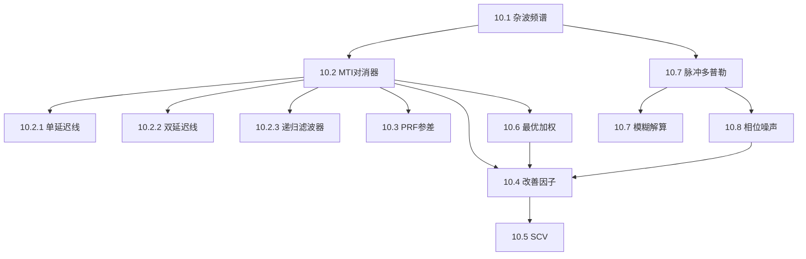

## 章节概述
本章介绍利用多普勒效应抑制杂波、检测运动目标的技术，包括MTI延迟线对消器、PRF参差、改善因子，以及脉冲多普勒雷达的信号处理方法。

## 小节间联系

- §10.1 描述杂波的频域特征，MTI的设计依据
- §10.2-10.3 MTI核心滤波技术
- §10.4-10.6 性能度量和优化
- §10.7 扩展到脉冲多普勒体制
- §10.8 实际系统的限制因素

## 关键术语

| 英文 | 中文 | 解释 |
|------|------|------|
| MTI (Moving Target Indicator) | 动目标显示 | 利用多普勒效应抑制静止杂波 |
| Delay Line Canceler | 延迟线对消器 | MTI的基本实现结构 |
| Blind Speed | 盲速 | 多普勒频率等于PRF整数倍的速度 |
| PRF Staggering | PRF参差 | 交替使用多个PRF消除盲速 |
| Improvement Factor | 改善因子 | MTI处理后的信杂比改善量 |
| SCV (Subclutter Visibility) | 杂波中可见度 | 可检测的杂波-目标功率比 |
| Pulsed Doppler | 脉冲多普勒 | 结合距离门和多普勒滤波的体制 |
| Phase Noise | 相位噪声 | 振荡器相位不稳定性 |

## 章节总结
本章是杂波抑制技术的核心。重点掌握：
1. 单/双延迟线对消器的频率响应和凹口特性
2. PRF参差消除盲速的原理
3. 改善因子与杂波频谱的关系
4. 脉冲多普勒雷达的多维信号处理架构
5. 相位噪声对MTI改善因子的限制
