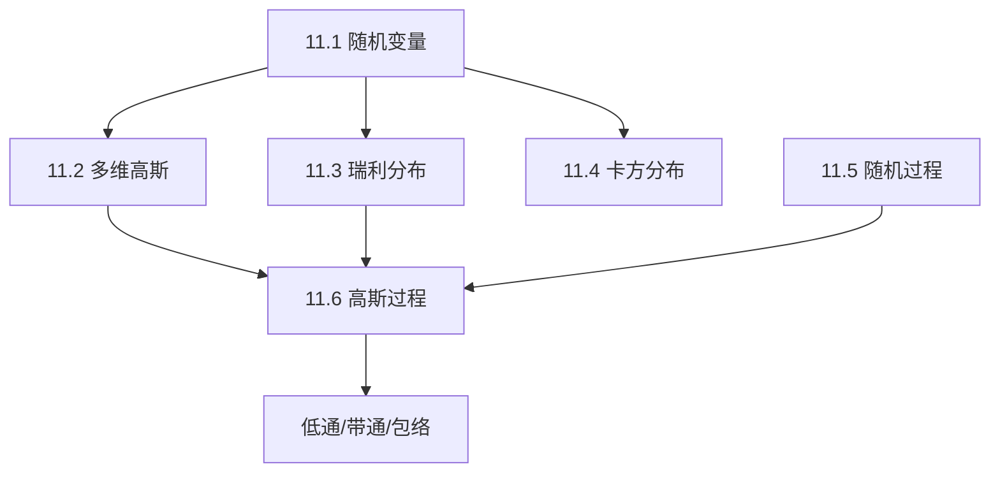

## 章节概述
本章建立雷达检测理论的概率统计基础，包括随机变量、多维高斯分布、瑞利分布、卡方分布、随机过程和高斯过程等概念。

## 小节间联系

- §11.1-11.4 建立随机变量的分布理论
- §11.5 扩展到随机过程
- §11.6 高斯过程是雷达噪声和杂波的基本模型

## 关键术语

| 英文 | 中文 | 解释 |
|------|------|------|
| Random Variable | 随机变量 | 取值由概率规律确定的变量 |
| Gaussian Distribution | 高斯分布 | 最常见的连续概率分布 |
| Rayleigh Distribution | 瑞利分布 | 高斯变量包络的分布 |
| Chi-Square Distribution | 卡方分布 | n个独立高斯变量的平方和分布 |
| Random Process | 随机过程 | 随时间演化的随机变量序列 |
| Stationary Process | 平稳过程 | 统计特性不随时间变化的随机过程 |
| Power Spectral Density | 功率谱密度 | 随机过程的频域描述 |

## 章节总结
本章为后续检测理论和CFAR的基础。重点掌握：
1. 瑞利分布是噪声包络的模型
2. 卡方分布用于Swerling起伏目标建模
3. 高斯随机过程的自相关与功率谱密度描述
4. 带通高斯过程的包络和相位分布
