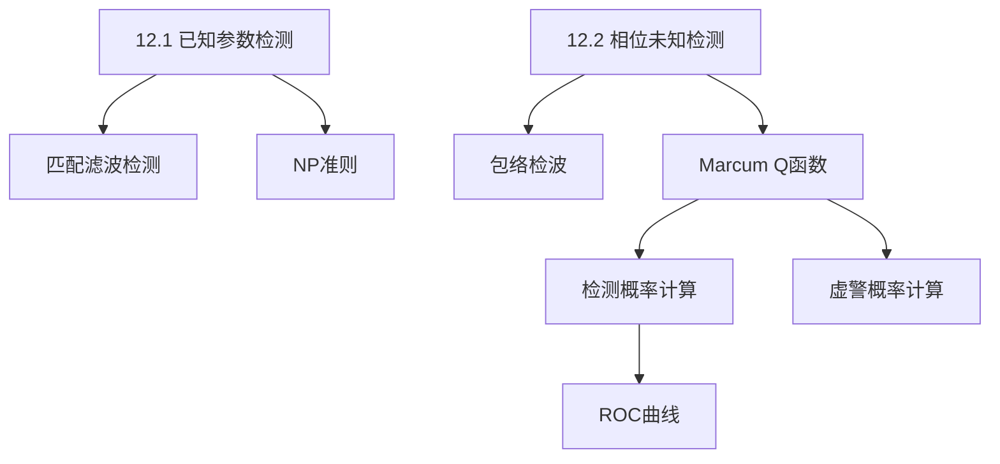

## 章节概述
本章研究单个脉冲的检测问题，建立奈曼-皮尔逊检测准则，推导已知参数和未知相位两种情况下的检测概率和虚警概率公式。

## 小节间联系

- §12.1 建立理想情况下的检测理论
- §12.2 处理更实际的未知相位情况

## 关键术语

| 英文 | 中文 | 解释 |
|------|------|------|
| Neyman-Pearson Criterion | 奈曼-皮尔逊准则 | 固定Pfa下最大化Pd的检测准则 |
| Probability of Detection (Pd) | 检测概率 | 目标存在时正确检测的概率 |
| Probability of False Alarm (Pfa) | 虚警概率 | 无目标时误报存在的概率 |
| Detection Threshold | 检测门限 | 判决信号有无的幅度门限 |
| Marcum Q-function | Marcum Q函数 | 未知相位检测的积分公式 |
| ROC (Receiver Operating Characteristic) | 接收机工作特性 | Pd与Pfa的关系曲线 |
| Envelope Detector | 包络检波器 | 提取信号包络的非线性器件 |

## 章节总结
本章奠定雷达检测理论的基础。重点掌握：
1. 奈曼-皮尔逊检测准则
2. 未知相位时的包络检测原理
3. Marcum Q函数的使用方法
4. ROC曲线的含义和工程应用
