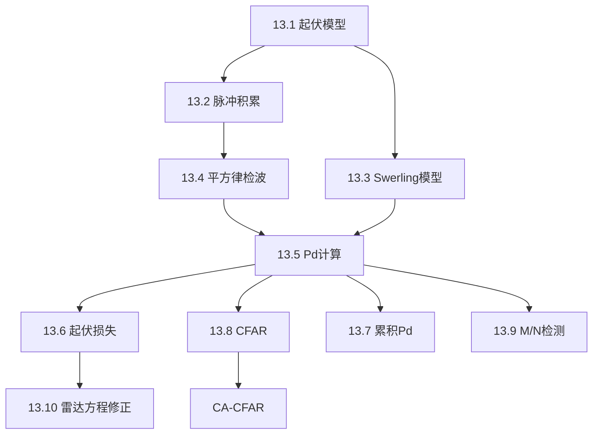

## 章节概述
本章将检测理论扩展到起伏目标（Swerling模型），涵盖脉冲积累、Swerling 0-5模型、CFAR检测、M/N检测等高级话题。

## 小节间联系

- §13.1-13.3 建立起伏目标的数学模型
- §13.4-13.5 给出Pd/Pfa的计算方法
- §13.6-13.10 扩展到工程实用技术

## 关键术语

| 英文 | 中文 | 解释 |
|------|------|------|
| Swerling Models | Swerling起伏模型 | 5种目标起伏统计模型 |
| Coherent Integration | 相干积累 | 脉冲间相位相干求和 |
| Noncoherent Integration | 非相干积累 | 脉冲包络求和 |
| Integration Loss | 积累损耗 | 非相干积累相对于相干积累的SNR损失 |
| CFAR (Constant False Alarm Rate) | 恒虚警率 | 自适应门限保持虚警恒定 |
| CA-CFAR | 单元平均CFAR | 参考窗平均估计噪声功率 |
| M-out-of-N Detection | M/N检测 | N次检测中M次确认 |
| Fluctuation Loss | 起伏损失 | 目标起伏导致的SNR损失 |

## 章节总结
本章是雷达检测理论的工程实现。重点掌握：
1. Swerling 0-V五种起伏模型的特征和适用场景
2. 相干/非相干积累的SNR改善和损耗
3. CA-CFAR的原理和参数设计
4. 各Swerling模型下Pd数值计算的方法
5. 起伏损失对雷达方程的影响
