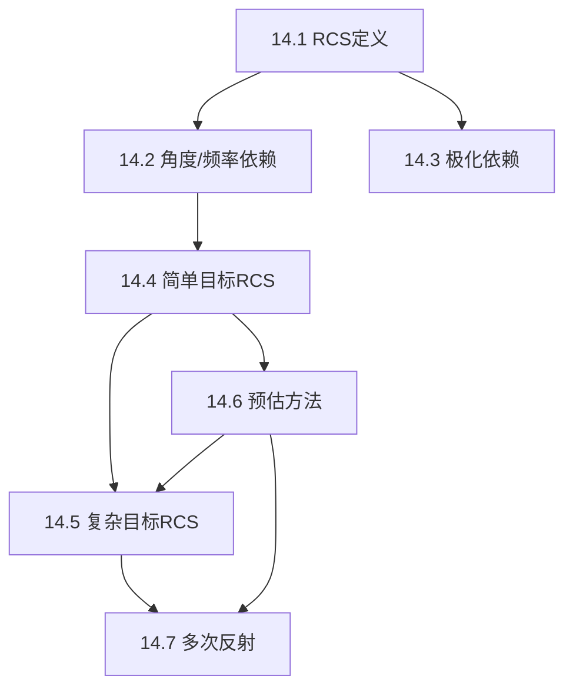

## 章节概述
本章系统介绍RCS的定义、特性及计算方法，包括RCS与视角/频率/极化/目标形状的依赖关系，以及简单几何体的RCS解析公式。

## 小节间联系

- §14.1-14.3 定义RCS及其基本特性
- §14.4 给出简单几何体的解析/半解析RCS
- §14.5-14.6 扩展到复杂目标的计算
- §14.7 多次反射的等效RCS放大

## 关键术语

| 英文 | 中文 | 解释 |
|------|------|------|
| Radar Cross Section (RCS) | 雷达截面积 | 目标散射能力的等效面积度量 |
| dBsm | dBsm | RCS的对数单位(dB relative to 1 m²) |
| Physical Optics (PO) | 物理光学 | 高频RCS近似计算方法 |
| Method of Moments (MoM) | 矩量法 | 低频精确数值方法 |
| FDTD | 时域有限差分 | 时域电磁场数值模拟 |
| Polarization Scattering Matrix | 极化散射矩阵 | 目标极化散射特性的完整描述 |
| Optical Region | 光学区 | 目标尺寸远大于波长的高频区 |
| Rayleigh Region | 瑞利区 | 目标尺寸远小于波长的低频区 |
| Resonant Region | 谐振区 | 目标尺寸与波长可比的中频区 |

## 章节总结
RCS是雷达目标特性的核心参数。重点掌握：
1. RCS与目标尺寸、波长、视角的关系（三区划分）
2. 简单几何体（球、板、柱）的RCS特征
3. 物理光学法的基本原理和适用范围
4. 复杂目标RCS的预估方法选择
