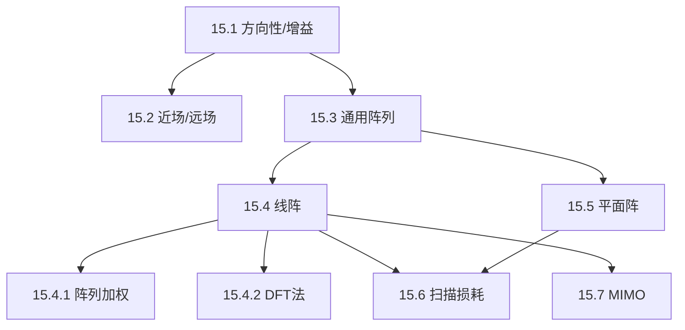

## 章节概述
本章系统介绍阵列天线理论，涵盖线阵、平面阵的方向图合成、波束扫描、阵列加权、MIMO线阵等内容。

## 小节间联系

- §15.1-15.3 建立天线基本参数和阵列基础
- §15.4-15.5 介绍两种基本阵列类型
- §15.6 分析扫描导致的性能变化
- §15.7 扩展到MIMO雷达新体制

## 关键术语

| 英文 | 中文 | 解释 |
|------|------|------|
| Array Factor | 阵因子 | 阵列几何决定的辐射方向图 |
| Grating Lobe | 栅瓣 | 阵元间距过大产生的多余波束 |
| Tapering / Weighting | 加权 | 改变阵元幅度分布以压低旁瓣 |
| Taylor Distribution | 泰勒分布 | 可控旁瓣的阵列加权 |
| Chebyshev Distribution | 切比雪夫分布 | 等旁瓣阵列加权 |
| Scan Loss | 扫描损耗 | 波束扫描时的增益降低 |
| MIMO Radar | MIMO雷达 | 多输入多输出雷达体制 |
| Virtual Array | 虚拟孔径 | MIMO雷达合成的更大有效孔径 |

## 章节总结
阵列天线是现代雷达的关键技术。重点掌握：
1. 阵因子与单元方向图的乘积原理
2. 线阵方向图的主瓣宽度、旁瓣高度与阵元数、间距的关系
3. 阵列加权压低旁瓣但展宽主瓣
4. 平面阵的二维波束扫描能力
5. MIMO雷达的虚拟孔径扩展原理
