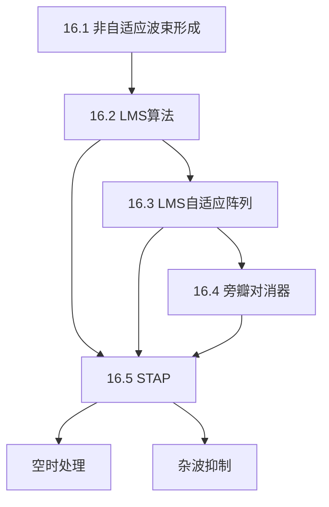

## 章节概述
本章介绍自适应信号处理在雷达中的应用，包括自适应波束形成、LMS算法、旁瓣对消器和空时自适应处理(STAP)。

## 小节间联系

- §16.1 建立常规波束形成基准
- §16.2-16.3 引入LMS自适应算法和阵列实现
- §16.4 简化的自适应结构
- §16.5 最先进的空时二维自适应处理

## 关键术语

| 英文 | 中文 | 解释 |
|------|------|------|
| LMS (Least Mean Square) | 最小均方 | 基于梯度的自适应滤波算法 |
| Beamforming | 波束形成 | 阵列加权合成方向图 |
| Adaptive Nulling | 自适应零陷 | 在干扰方向自动形成波束零点 |
| SLC (Sidelobe Canceler) | 旁瓣对消器 | 利用辅助天线对消旁瓣干扰 |
| STAP (Space-Time Adaptive Processing) | 空时自适应处理 | 联合空时二维自适应滤波 |
| Clutter Ridge | 杂波脊 | STAP中杂波在空时平面的分布 |
| Degrees of Freedom | 自由度 | 自适应处理的独立调节维数 |
| MVDR | 最小方差无畸变响应 | 自适应波束形成的最优准则 |

## 章节总结
自适应处理显著提升了雷达在复杂电磁环境中的性能。重点掌握：
1. LMS算法的基本原理和收敛特性
2. 自适应阵列在干扰方向形成零陷的机制
3. STAP联合利用空时二维自由度抑制杂波
4. 全维STAP计算量大，需采用降维方法
