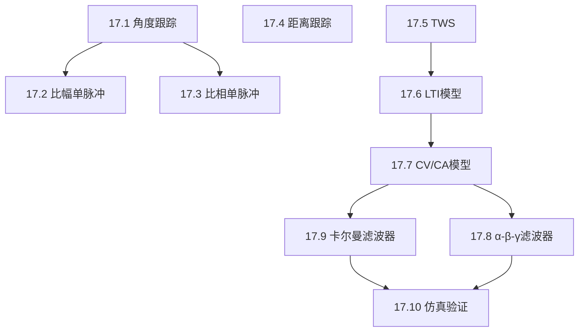

## 章节概述
本章系统介绍雷达目标跟踪技术，包括角度跟踪（顺序波瓣/圆锥扫描/单脉冲）、距离跟踪、固定增益滤波器（α-β-γ）和卡尔曼滤波器。

## 小节间联系

- §17.1-17.3 角度测量与跟踪的硬件实现
- §17.4 距离跟踪的分裂门技术
- §17.6-17.7 建立跟踪的数学模型
- §17.8-17.9 两种滤波器设计方法（固定增益 vs 自适应增益）
- §17.10 仿真验证滤波器性能

## 关键术语

| 英文 | 中文 | 解释 |
|------|------|------|
| Monopulse | 单脉冲 | 单脉冲内完成角度测量的技术 |
| Sequential Lobing | 顺序波瓣 | 交替比较波束回波测角 |
| Conical Scan | 圆锥扫描 | 波束绕视线旋转的测角方法 |
| Split Gate | 分裂门 | 距离跟踪的误差提取技术 |
| α-β Filter | α-β滤波器 | 位置-速度跟踪的固定增益滤波器 |
| α-β-γ Filter | α-β-γ滤波器 | 位置-速度-加速度跟踪的固定增益滤波器 |
| Kalman Filter | 卡尔曼滤波器 | 最优递推状态估计滤波器 |
| State Variable | 状态变量 | 描述系统动态的最小参数集 |
| Track-while-Scan (TWS) | 边扫描边跟踪 | 扫描搜索同时维持多目标跟踪 |

## 章节总结
跟踪是雷达系统的核心功能之一。重点掌握：
1. 单脉冲测角的和差通道原理
2. α-β(γ)滤波器的增益设计和稳态特性
3. 卡尔曼滤波器的预测-更新迭代过程
4. 固定增益滤波器与卡尔曼滤波器的区别和联系
5. 状态空间模型建立和观测方程
