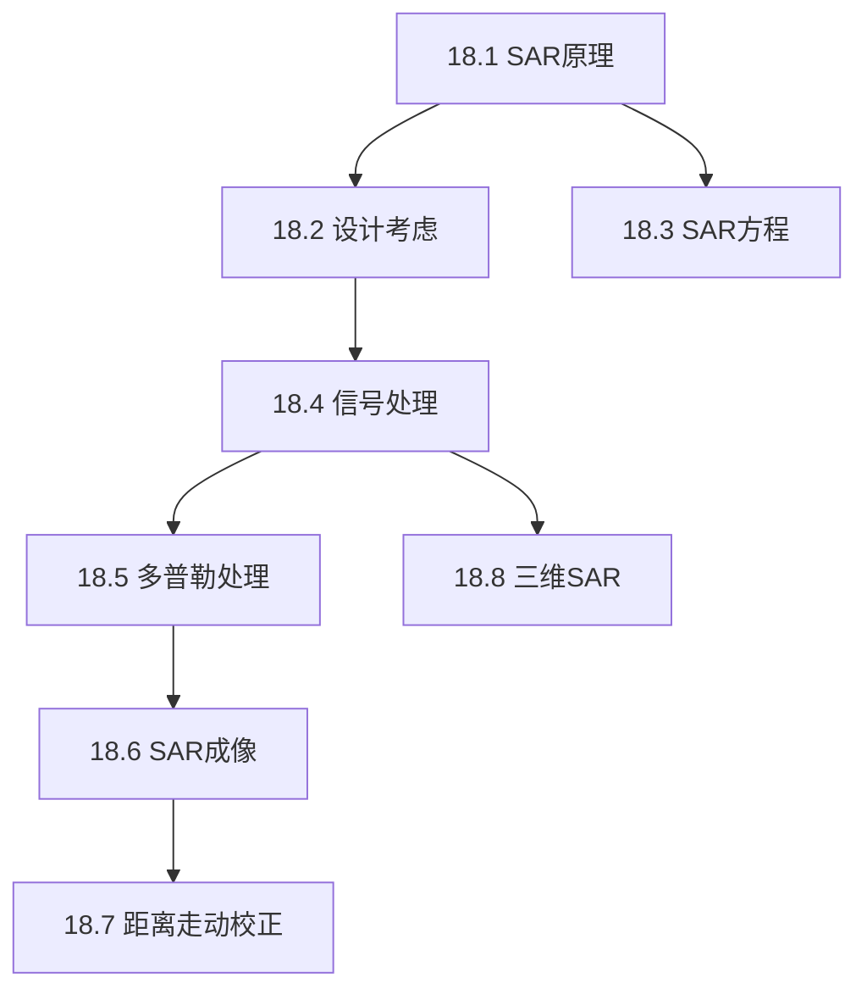

## 章节概述
本章介绍合成孔径雷达(SAR)的基本原理和信号处理方法，通过平台运动合成大孔径实现高方位分辨率。

## 小节间联系

- §18.1-18.3 建立SAR基础和设计约束
- §18.4-18.6 介绍SAR的二维信号处理
- §18.7 解决运动补偿问题
- §18.8 扩展到三维成像

## 关键术语

| 英文 | 中文 | 解释 |
|------|------|------|
| Synthetic Aperture Radar (SAR) | 合成孔径雷达 | 利用平台运动合成大孔径的成像雷达 |
| Azimuth Resolution | 方位分辨率 | SAR沿航迹方向的分辨能力 |
| Range Walk | 距离走动 | 运动目标/平台引起的距离单元变化 |
| Doppler History | 多普勒历史 | 目标回波多普勒频率随时间的变化 |
| Range-Doppler Algorithm | 距离-多普勒算法 | SAR最经典的成像算法 |
| Side-looking SAR | 侧视SAR | 天线指向航迹垂直方向的SAR构型 |
| Spotlight SAR | 聚束SAR | 天线持续照射同一区域的SAR模式 |
| Stripmap SAR | 条带SAR | 天线固定视角的条带成像模式 |

## 章节总结
SAR利用平台运动突破了实孔径天线的方位分辨率限制。重点掌握：
1. SAR方位分辨率与天线尺寸的关系（D/2）
2. SAR信号处理的二维匹配滤波特性
3. 距离走动及其校正的必要性
4. SAR模式（条带/聚束）的区别和适用场景
